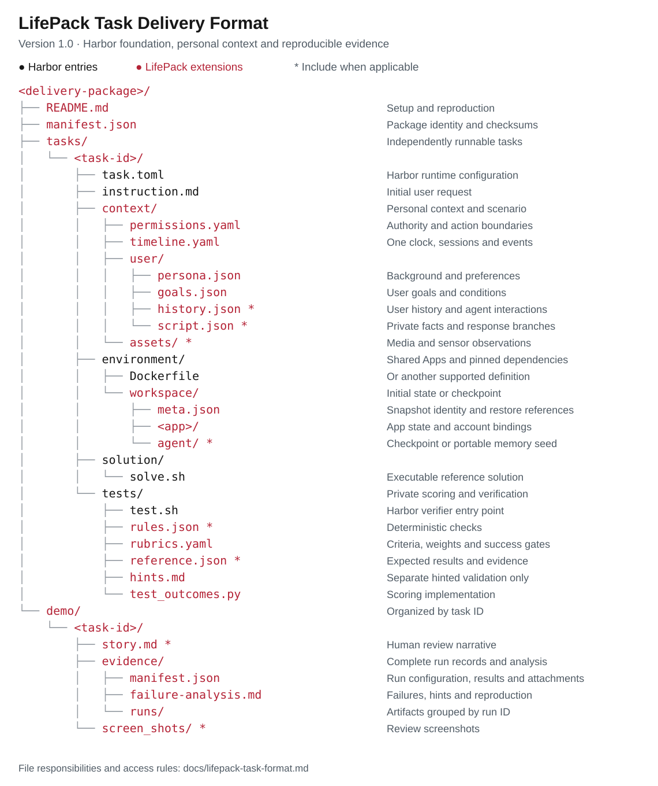

# LifePack Task Delivery Format

**Version 1.0 · Final delivery specification · November 24, 2026**

**LifePack = Life + Package.** It packages a person's context, connected environments, evolving interactions and evaluation criteria into a reproducible personal-agent task for **Personal Agents' Last Exam**.

LifePack preserves the [Harbor task structure](https://docs.harborframework.com/tasks/overview) and adds personal context and delivery evidence. This is the format for **completed Task Track implementations**. Initial [proposal PRs](../proposals/templates/task-proposal.md) describe the plan; authors deliver the package and validation evidence in the same PR after plan approval.

The format is finalized here. The shared LifePack loader, global scheduler and user harness remain separate infrastructure work. A delivery must identify and demonstrate its tested runtime/adapter; a directory tree alone does not establish execution support. See the [environment architecture](environment-architecture.md).

## Package layout

**Black:** Harbor's existing task entries. **Red:** LifePack packaging and extensions. Color identifies origin, not whether an entry is required. Optional entries are marked `*`; details follow below.



<details>
<summary>Copyable directory tree</summary>

```text
<delivery-package>/
├── README.md
├── manifest.json
├── tasks/
│   └── <task-id>/
│       ├── task.toml
│       ├── instruction.md
│       ├── context/
│       │   ├── permissions.yaml
│       │   ├── timeline.yaml
│       │   ├── user/
│       │   │   ├── persona.json
│       │   │   ├── goals.json
│       │   │   ├── history.json             *
│       │   │   └── script.json              *
│       │   └── assets/                      *
│       ├── environment/
│       │   ├── Dockerfile
│       │   └── workspace/
│       │       ├── meta.json
│       │       ├── <app>/
│       │       └── agent/                   *
│       ├── solution/
│       │   └── solve.sh
│       └── tests/
│           ├── test.sh
│           ├── rules.json                  *
│           ├── rubrics.yaml
│           ├── reference.json              *
│           ├── hints.md
│           └── test_outcomes.py
└── demo/
    └── <task-id>/
        ├── story.md                        *
        ├── evidence/
        │   ├── manifest.json
        │   ├── failure-analysis.md
        │   └── runs/
        └── screen_shots/                   *
```

</details>

Use stable lowercase task IDs with hyphens. The same ID links `tasks/<task-id>/`, `demo/<task-id>/`, the manifest and the proposal. Keep this layout even for a one-task package. Omit unused optional files instead of adding empty placeholders.

`Dockerfile` can be replaced by another environment definition supported by the pinned Harbor version, such as `docker-compose.yaml`, or a pinned prebuilt image. `test_outcomes.py` is the conventional scoring implementation; another language/file is allowed when `test.sh` invokes it. These choices must be documented in the package README. Harbor's configuration and entry points retain their original meanings. See [environment configuration](https://docs.harborframework.com/tasks/environment) and [task configuration](https://docs.harborframework.com/tasks/configuration).

## What each part contains

| File or directory | Delivery content |
| :--- | :--- |
| `README.md` | Task catalog, linked proposals, setup/reset/run/score instructions, exact tested versions, required credentials by variable name, and execution mode. State sessions, simulated duration and estimated total tokens, including the estimate's scope. |
| `manifest.json` | Package identity/version, task locations, resolved dependencies and file hashes. See the manifest contract below. |
| `task.toml` | Valid Harbor runtime configuration: resource budgets, timeouts and supported environment/agent settings. It is not the story or user script. |
| `instruction.md` | The initial user request delivered to the evaluated agent. |
| `context/permissions.yaml` | Initial authority, data access, action limits and confirmation requirements. Subsequent consent changes are triggered through the timeline or user script and recorded at runtime. |
| `context/timeline.yaml` | Initial simulated time and timezone, sessions, time advancement, scheduled/conditional events, tie ordering and termination conditions. One session with no events is valid. |
| `context/user/persona.json` | Relevant background, preferences, relationships and communication characteristics. |
| `context/user/goals.json` | User goals, dependencies, goal-change conditions and completion conditions. Rubric points belong in `tests/`, not here. |
| `context/user/history.json` | Optional user history **and cross-session user–agent interactions**. Preserve timestamps, roles, sources and visibility/retrieval rules. Reference App records by stable ID instead of maintaining a second authoritative copy. |
| `context/user/script.json` | Required when the scenario includes simulated user interaction: private facts, disclosure conditions, clarification, refusals, approval/withdrawal, intent changes and no-reply branches. Describe responses to different valid agent strategies. |
| `context/assets/` | Optional audio, images, video, documents, sensor time series and other observations. Record source, media type, timestamps/timebase, availability and access rules; reference large files by immutable artifact identity. |
| `environment/workspace/meta.json` | Snapshot identity, simulated time, data/schema versions, App/account bindings and restore references. Declare an initial start or a checkpoint start. |
| `environment/workspace/<app>/` | Task-specific App state or references to versioned seeds. Use the App's existing data and tool contracts. At least one binding is needed for a task that uses Apps. |
| `environment/workspace/agent/` | Optional compatible agent checkpoint or portable memory seed. Declare which it is and its supported adapter/version. This is state already available at the chosen starting point. |
| `solution/solve.sh` | Executable reference solution using the same permitted interfaces and scenario constraints as the evaluated agent. Supporting replay files may live alongside it. LifePack requires a reference solution for validation, although Harbor makes this directory optional. |
| `tests/rubrics.yaml` | Stable rubric IDs, weights, evaluator types, evidence sources, partial credit, forbidden actions, success gates and the full-pass rule. Preserve the approved proposal's criteria. |
| `tests/rules.json`, `tests/reference.json` | Optional deterministic rules and expected outcomes/evidence. Keep one source of truth for each criterion and reference its rubric ID. |
| `tests/hints.md` | Fixed hint text and injection point for a separate hinted run. It is unavailable during ordinary rollouts. |
| `tests/test.sh` and scoring code | Execute the verifier, emit the Harbor reward and retain item-level scores, gate results and supporting evidence. |
| `demo/<task-id>/story.md` | Optional human review narrative: background, story, personalization insight and a reference to the approved proposal. It is not agent context or an executable scenario. |
| `demo/<task-id>/evidence/` | Run manifest, complete run artifacts and failure analysis. Include reference, unhinted, hinted and grader-validation runs. |
| `demo/<task-id>/screen_shots/` | Optional screenshots linked to task/run IDs and timestamps. Multimodal inputs belong in `context/assets/`. |

Structured payloads must identify the schema or adapter version that consumes them. This specification fixes file responsibilities and required information; App schemas, sensor encodings and agent checkpoint internals belong to their versioned implementations.

## One timeline, consistent state

`timeline.yaml` is the **time backbone**. The runner executes it; Apps use Core's `ctx.virtual_now`. Record offset-aware timestamps, session IDs and event IDs. Keep real execution dates and wall-clock duration separate from simulated time. Give simultaneous events an explicit order and record which conditions triggered each event.

Before starting or resuming a session, process due events, synchronize every participating App and verify the clock barrier. Core's `env.advance_time` provides the per-App operation; it does not schedule a complete task. Follow the [implemented time contract](runtime-time.md).

A checkpoint must align App state, agent state, the simulated clock, event cursor, user-harness state, permissions and pending deliveries. `workspace/meta.json` identifies the matching snapshots and versions. The loader must reject incompatible or incomplete restores and avoid repeating committed actions. A portable memory seed does not by itself claim exact checkpoint replay. Record how the same task context is provided across supported agent models, including any adapter-specific differences. Reset restores the declared starting point for each independent rollout.

For tasks involving external platforms, the first simulated session starts **on or after 2026-01-01**. User interactions with external platforms date **on or after 2025-01-01**. Earlier text-only personal history and user–agent conversations remain allowed. These are the [Task Track timeline rules](../proposals/templates/task-proposal.md#6-construction-plan-and-effort).

## Who can read what

| Reader | Available material | Boundary |
| :--- | :--- | :--- |
| Evaluated agent | Initial request; permitted history/memory; App tools, records and media exposed by the task protocol | No hidden goals, future events, undisclosed private facts, reference solution, grader, hints or author evidence. |
| User simulator | Persona, goals, script and relevant history | Reveal private facts only under the scripted conditions; no rubric or reference-answer access. |
| Runner / environment | Timeline, permissions, bindings, snapshots and delivery state | Enforce access and time; expose only authorized views to the agent. |
| Verifier | Rubrics, rules, expected results, trusted observations and actual execution evidence | Grade outcomes independently of agent claims; do not disclose scoring internals during the run. |
| Human reviewer | Complete package and demo/evidence | Review-only explanations are excluded from ordinary agent context. |

Access is enforced by mounts, process/service boundaries and authenticated interfaces, not directory names. Do not mount the complete delivery package into the agent sandbox. Private user data must also be isolated from agent-accessible services. `history.json` may contain both accessible and private records; the adapter supplies only the authorized view. Hints are injected by the controller solely in the designated hinted run.

## Package identity and dependencies

The root `manifest.json` is the single package catalog and integrity index. It contains:

| Field | Required value |
| :--- | :--- |
| `format`, `format_version` | `"lifepack"`, `"1.0"` |
| `package_id`, `package_version` | Stable package ID and immutable release version. |
| `tasks` | Entries with `id`, `path`, `proposal_url`, `primary_domain`, `secondary_domains` and dependency IDs. Paths resolve to `tasks/<task-id>/`; domains use the [shared domain names](../CONTRIBUTING.md#environment-domains). |
| `dependencies` | Each dependency's ID, kind, exact resolved version/revision and retrievable source. Include Harbor, the runner/adapter, Core/Apps and any external datasets used. Pin container images by digest. |
| `files` | Package-relative path to SHA-256 mappings for all delivered files except this root manifest. Paths must remain inside the package. |
| `artifacts` | Optional external file entries: ID, immutable revision, URI, SHA-256, media type, size and intended local path. Hash the downloaded bytes and verify before use. |

Resolved dependencies are package-level records; each task selects its dependencies by ID. Additional generated search/catalog indexes are allowed, but must derive from this manifest and task metadata. Do not maintain competing hand-edited catalogs. Store large datasets, media and run attachments in versioned artifact storage with these references; keep reviewable specifications and small fixtures in Git.

Reuse the project's shared [App/Core/Messaging contracts](app-integrations.md). A task provides seeds, bindings and interactions rather than a forked runtime or a copy of every App. App business tools and permissions remain authoritative; any task-specific tool view must be generated from or checked against the selected App contracts.

## Optional capabilities

Include only capabilities used by the task and supported by its declared adapter:

- **Interfaces:** `environment/interface/` may hold task-specific agent instructions, generated tool views or skills. Use Harbor's native MCP/skills configuration where supported. Declare connection roles and endpoints; keep management interfaces inaccessible to the agent.
- **Web and CUA:** `environment/web/` may hold frozen pages, search results and replay metadata. An interactive website instead needs a tested browser/API adapter sharing authoritative App state. Frozen pages alone do not implement dynamic transactions.
- **Multiple services:** Harbor's supported Compose setup can separate Apps, the user harness and verification. Sidecars are an implementation choice, not an additional required LifePack layer.
- **Multimodal and device observations:** keep files and streams under `context/assets/` or referenced artifact storage. Define sampling/time alignment, delivery conditions and the accessible interface. No fixed device list or sensor file encoding is required.

Document network use for the environment, agent, user simulator and grader separately. A frozen environment can still require remote models. Reference replay or a cached judge result may test a known fixture; it cannot establish a score for a new agent rollout. LLM-judge configuration, prompts, versions and aggregation must be reproducible; three-judge majority voting is optional.

## Scoring and evidence

The verifier must write Harbor's `/logs/verifier/reward.txt` or `/logs/verifier/reward.json`. For LifePack, retain both the **normalized rubric score** and **full-task pass/fail**, with item-level results and required gates; they are different outcomes. If using labeled JSON rewards, document the metric selected for aggregation. See the [Harbor verifier contract](https://docs.harborframework.com/tasks/verifier).

The runner collects these runtime outputs into `demo/<task-id>/evidence/`; the agent never writes the authoritative evidence manifest. When verification runs separately, explicitly transfer the required App snapshots and execution records. A verifier starting from the original seed cannot grade the agent's final state.

The evidence `manifest.json` indexes each run by task ID and unique run ID, with:

- Run type, task/package revision, input hashes, model identifiers, agent/user/grader configurations, dependency versions, seed, budgets and execution date.
- Session count, simulated start/end, real duration, token usage and costs when available.
- Raw and normalized rubric scores, per-item results, gate outcomes and full-task pass/fail.
- Complete transcripts, tool calls/results, user and world events, relevant final state, hint injection and verifier outputs, as local paths or immutable attachments with checksums.
- Infrastructure errors, retries or incomplete runs explicitly distinguished from task failures.

Use `runs/<run-id>/` for each local run's artifacts; imported Harbor trial layouts may be retained within it. `failure-analysis.md` explains substantive failures, hint-assisted outcomes and reproduction steps. Preserve all attempted validation runs, including successful runs and infrastructure errors, and identify the scored batch.

The current model roster, minimum rollout count, score thresholds and hinted-validation requirements live in [Task difficulty and validation](../CONTRIBUTING.md#task-difficulty-and-validation). Follow that policy without duplicating a moving roster in this format specification.

## Final delivery checks

1. Resolve every dependency and artifact from a clean setup; verify hashes and the pinned Harbor configuration. Document actual setup, reset, run and score commands for the selected adapter.
2. Demonstrate initial-state reset and, when applicable, checkpoint consistency, cross-App outcomes, session/event ordering and visibility isolation.
3. Run the reference solution through the declared interfaces and verifier. It must earn a full score; doing nothing must fail. Exercise representative incorrect/partial outcomes and at least one declared valid alternative.
4. Submit the policy-required model rollouts, separate hinted runs, complete evidence and failure analysis. Demonstrate the claimed Harbor integration, not only a custom offline replay.
5. Link the package version and evidence from the **same approved proposal PR**. Maintainers validate and accept the implementation before merge through the [contribution lifecycle](review/proposal-lifecycle.md).

Future schema changes must use an explicit format version and migration notes. Existing releases and their evaluation evidence remain reproducible.
